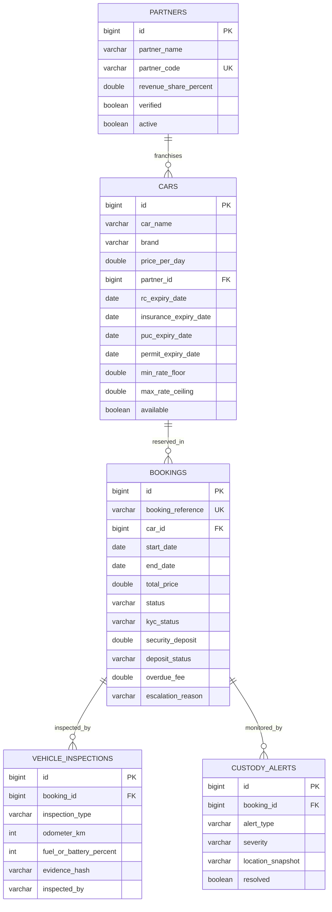
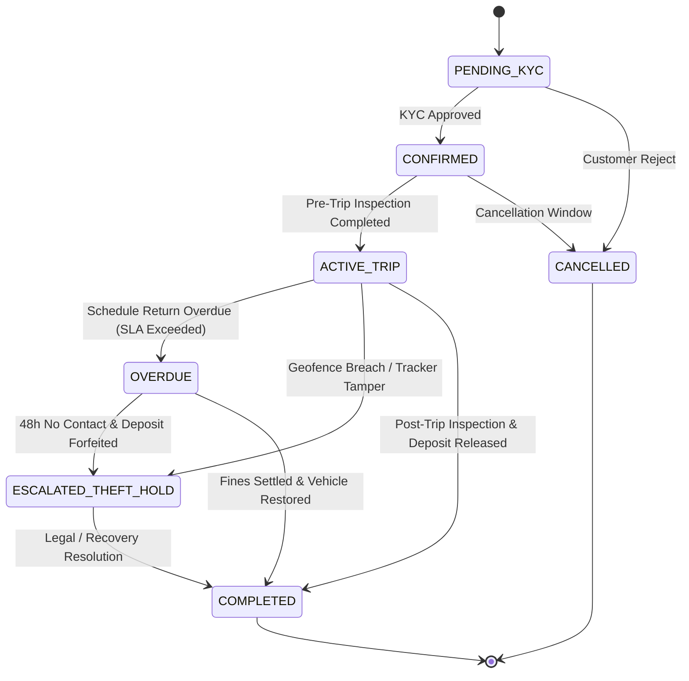

# AI-Powered Car Rental & Fleet Custody Operating System (CARVIA)

[](https://www.oracle.com/java/)
[](https://spring.io/projects/spring-boot)
[](https://flywaydb.org/)
[](https://supabase.com/)
[](https://aistudio.google.com/)
[]()

> **Mini Project (BCC 351) — Final Architecture & Evaluation Report**  
> **Department of Computer Science & Engineering**  
> **IMS Engineering College, Ghaziabad**  
> *(Affiliated to Dr. A.P.J. Abdul Kalam Technical University, Lucknow | Academic Session 2026-27)*

---

## 👥 Project Team & Supervision

- **Supervisor:** **Dr. Sonali Mathur** (Professor, Department of CSE)
- **Project Group:** **Group No. G2**

| S.No. | Student Name | University Roll Number |
|:---:|:---|:---:|
| 1 | **Aadesh Rai** | `2501430100001` |
| 2 | **Abhishek Singh** | `2501430100014` |
| 3 | **Ambuj Kumar Srivastava** | `2501430100042` |
| 4 | **Amrit Kumar Srivastava** | `2501430100047` |
| 5 | **Abhay Gupta** | `2501430100010` |

---

## 🚀 Architectural Overview (Step 1 & Step 2 Milestones)

CARVIA evolved from a basic vehicle listing catalog into a **concurrency-safe, franchise-ready Fleet & Custody Operating System** featuring:

1. **Production-Grade Database Evolution:**
   - Managed schema versioning via **Flyway V1 (`V1__init_carvia_schema.sql`)** and **V2 (`V2__partner_custody_pricing_upgrade.sql`)**.
   - Profile-driven architecture (`dev` with H2 in-memory `MODE=PostgreSQL`, and `prod` with **Supabase PostgreSQL 17 via IPv4 Session Pooler**).
   - Hibernate schema validation (`ddl-auto=validate`) guaranteeing zero uncontrolled schema drift.

2. **Concurrency Safety & Double-Booking Prevention:**
   - **Pessimistic Write Locking (`@Lock(LockModeType.PESSIMISTIC_WRITE)`)** on target vehicle rows to serialize concurrent reservation attempts.
   - Distinct **HTTP 409 Conflict** error mapping via `BookingConflictException`.

3. **Step 2A: Custody Proof, Overdue Fines & Theft Escalation:**
   - **Strict Booking State Machine:** `PENDING_KYC` ➔ `CONFIRMED` ➔ `ACTIVE_TRIP` ➔ `OVERDUE` ➔ `ESCALATED_THEFT_HOLD` ➔ `COMPLETED`.
   - Pre-trip and post-trip digital condition proof with cryptographic evidence hashing (`evidenceHash`), odometer, and battery/fuel levels.
   - Geofence tamper & theft detection triggering automatic theft holds and security deposit forfeiture.
   - Live audit dossier generator: `GET /api/bookings/{id}/custody-dossier`.

4. **Step 2B: Partner / Franchise Fleet & Compliance OS:**
   - Franchise partner profiles (`Partner`) with custom revenue-share models (e.g., 82.5% partner yield).
   - Document compliance engine (RC, Insurance, PUC, Commercial Permit). Bookings are strictly blocked with **HTTP 422 Unprocessable Entity** if vehicle documents are expired.
   - Fleet-wide compliance audit reporting: `GET /api/partners/fleet/compliance-report`.

5. **Step 2C: AI Dynamic Rate & Yield Advisor:**
   - Real-time yield optimization engine powered by **Google Gemini AI** (`GET /api/ai/pricing-advice/{carId}`).
   - Multi-factor deterministic fallback engine (weekend demand multipliers, fleet occupancy, luxury/SUV segment uplifts) and in-memory thread-safe caching (`ConcurrentHashMap`) for zero downtime.

---

## 🏛️ System Architecture Diagrams

### 1. Unified Entity-Relationship & Flyway Migration Schema



### 2. Custody & Escalation State Machine



---

## 🛠️ REST API Specification (Selected Endpoints)

| Method | Endpoint | Description | Status Code |
|---|---|---|---|
| `GET` | `/api/cars` | Fetch all available vehicles | `200 OK` |
| `POST` | `/api/bookings` | Create reservation with pessimistic lock | `201 Created` / `409 Conflict` |
| `GET` | `/api/bookings/{id}/custody-dossier` | Audit dossier (inspections, alerts, KYC) | `200 OK` |
| `POST` | `/api/bookings/{id}/inspections` | Record pre/post-trip vehicle inspection | `201 Created` |
| `POST` | `/api/bookings/{id}/alerts` | Ingest geofence/tamper alert | `201 Created` |
| `GET` | `/api/partners/fleet/compliance-report` | Audit RC/Insurance/PUC compliance | `200 OK` |
| `GET` | `/api/ai/pricing-advice/{carId}` | AI dynamic rate & franchise yield advice | `200 OK` |

---

## 💻 Running the Application

### Dev Mode (H2 In-Memory)
```powershell
.\mvnw.cmd spring-boot:run
```
*App runs on `http://localhost:8080`, with H2 web console active on `http://localhost:8080/h2-console`.*

### Prod Mode (Supabase PostgreSQL Pooler)
```powershell
$env:SPRING_PROFILES_ACTIVE="prod"
$env:SPRING_DATASOURCE_URL="jdbc:postgresql://aws-0-ap-northeast-1.pooler.supabase.com:5432/postgres?sslmode=require"
$env:SPRING_DATASOURCE_USERNAME="postgres.jazkltqnyqaiywbhtine"
$env:SPRING_DATASOURCE_PASSWORD="<your_password>"

.\mvnw.cmd spring-boot:run
```

### Running the Test Suite
```powershell
.\mvnw.cmd test
```

---

## 🎓 60-Second Viva / Presentation Pitch (BCC 351)

> *"Good morning, respected examiners. CARVIA is an AI-powered fleet management and car rental platform designed to solve the critical vulnerabilities of real-world rental operations: double-booking race conditions, regulatory compliance failures, vehicle theft, and static sub-optimal pricing.*
> 
> *Our engineering highlights:*
> 1. *First, we implemented a robust two-tier database architecture managed through Flyway migrations on PostgreSQL, enforcing strict row-level pessimistic write locking to make double-booking mathematically impossible under concurrent requests.*
> 2. *Second, our Custody & Compliance OS tracks vehicle document expiry dates—automatically blocking expired vehicles from hitting the road—and governs the vehicle custody lifecycle through pre-and-post-trip digital inspections with tamper evidence hashing.*
> 3. *Third, our real-time Theft Escalation Engine detects geofence breaches and overdue SLAs, immediately locking security deposits and generating a full Audit Dossier.*
> 4. *Finally, our AI Dynamic Pricing Engine leverages Google Gemini with a deterministic fallback to optimize daily rates and franchise owner yield based on localized demand factors and calendar occupancy.*
> 
> *The entire system is deployed with automated integration tests, zero-duplicate data seeders, and a reactive frontend running on Spring Boot 3.3 and Java 21."*
