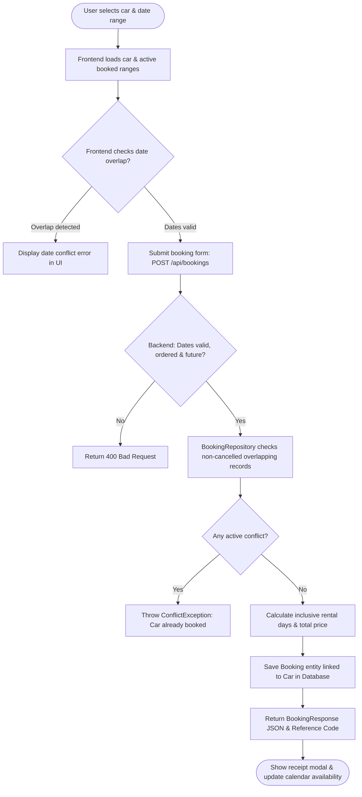
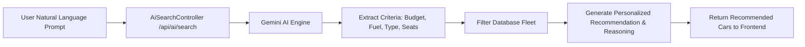

# AI-Powered Car Rental System (CARVIA)

[](https://www.oracle.com/java/)
[](https://spring.io/projects/spring-boot)
[](https://aistudio.google.com/)
[](https://supabase.com/)
[]()

> **Mini Project (BCC 351) — Review 2**  
> **Department of Computer Science & Engineering**  
> **IMS Engineering College, Ghaziabad**  
> *(Affiliated to Dr. A.P.J. Abdul Kalam Technical University, Lucknow | Academic Session 2026-27)*

---

## 👥 Project Team & Supervision

- **Supervisor:** **Dr. Sonali Mathur** (Professor, Department of CSE)
- **Project Group:** **Group No. G2**

| S.No. | Student Name | University Roll Number |
|:---:|:---|:---:|
| 1 | **Aadesh Rai** | `2501430100001` |
| 2 | **Abhishek Singh** | `2501430100014` |
| 3 | **Ambuj Kumar Srivastava** | `2501430100042` |
| 4 | **Amrit Kumar Srivastava** | `2501430100047` |
| 5 | **Abhay Gupta** | `2501430100010` |

---

## 📌 Problem Statement

Traditional car rental platforms typically present users with an overwhelming catalog of vehicles without considering their individual preferences, budget constraints, travel context, or passenger capacity.
- **Manual Overhead:** Users must manually check dozens of vehicles, compare fuel types, daily pricing, availability schedules, and vehicle specifications.
- **Static Filters:** Conventional systems rely on rigid dropdowns and boolean filters that cannot interpret colloquial or situational search intent (e.g., *"Need a comfortable 7-seater SUV for a 4-day mountain trip with friends on a modest budget"*).
- **Booking Overlaps & Friction:** Many basic systems lack dynamic date-conflict prevention, leading to overlapping booking disputes or booking errors.

---

## 🎯 Objectives & Aims

1. **Intelligent Natural Language Vehicle Discovery:** Empower users to describe their journey or vehicle requirements in natural language and receive context-aware recommendations via Google Gemini AI.
2. **Personalized Recommendations:** Match user requirements (budget, seats, transmission, fuel, body type) to the available fleet with clear AI reasoning.
3. **Robust Booking & Availability Engine:** Prevent date conflicts through automated calendar overlap checks at both repository and controller levels.
4. **Intuitive End-to-End User Experience:** Provide a modern web interface with real-time price estimation, disabled booked date ranges, instant booking receipts, and car listing capabilities.

---

## 🛠️ System Architecture & Methodology

### Booking Conflict & Verification Flow



### AI Recommendation Flow



---

## 💻 Tech Stack

| Layer | Technology | Details |
|:---|:---|:---|
| **Frontend** | HTML5, CSS3, Vanilla JavaScript (ES6+) | Responsive UI, interactive booking modals, date pickers, fetch API |
| **Backend** | Java 21, Spring Boot 3.3.4 | Spring Web, Spring Data JPA, Hibernate ORM, Bean Validation |
| **AI Integration** | Google Gemini API (Gemini 3.8 Flash) | Natural language prompt parsing & personalized recommendation |
| **Database** | PostgreSQL (Supabase Cloud) | Relational persistence with foreign keys, index optimization |
| **Build & Tooling** | Apache Maven 3.9+, Git & GitHub | Maven Wrapper (`mvnw`), GitHub Actions CI |

---

## 📚 Literature Survey

| Author / Source | Existing Work | Relevance to Our Project |
|:---|:---|:---|
| **Rathore & Chaudhary (2018)**, *IJMB* | Surveyed 300+ customers analyzing India's self-drive rental industry, customer expectations, and fleet demand patterns. | Informs our feature set: clear pricing breakdown, fleet diversity, and transparent fuel/mileage terms. |
| **Mobility Foresights (2024–2030)** | Market analysis on India's self-drive vehicle growth, major operators, and tech-driven booking shifts. | Validates demand for automated, frictionless digital booking platforms. |
| **Genikomsakis & Ioakimidis (2018)**, *Sustainable Cities and Society* | Assessed customer adoption and fleet management dynamics for EV/sharing services. | Guided inclusion of modern electric vehicles (e.g., Tata Nexon EV) and flexible rental period calculations. |

---

## 🚀 API Endpoints Overview

### Cars (`/api/cars`)
- `GET /api/cars` — Fetch all available cars
- `GET /api/cars/featured` — Fetch featured cars for homepage
- `GET /api/cars/{id}` — Fetch details for a specific car
- `POST /api/cars` — List a new car (with validation)
- `PUT /api/cars/{id}` — Update car details
- `DELETE /api/cars/{id}` — Remove a car

### Bookings (`/api/bookings`)
- `POST /api/bookings` — Create a new verified booking
- `GET /api/bookings/{id}` — Retrieve booking by ID
- `GET /api/bookings/reference/{ref}` — Retrieve booking receipt by reference code
- `GET /api/bookings/car/{carId}/booked-ranges` — Get non-cancelled date ranges for calendar blocking
- `GET /api/bookings/car/{carId}/check-availability` — Verify date range availability
- `PATCH /api/bookings/{id}/cancel` — Cancel an existing booking

### AI Search (`/api/ai`)
- `POST /api/ai/search` — Query cars using natural language with Gemini API

---

## ⚙️ Running Locally

### Prerequisites
- **JDK 21** or later installed
- **Git**
- Free **Google Gemini API Key** from [Google AI Studio](https://aistudio.google.com/)
- PostgreSQL database (or free [Supabase](https://supabase.com/) PostgreSQL instance)

### 1. Clone Repository
```bash
git clone https://github.com/MyBeerZ9/Mini-Project.git
cd Mini-Project
```

### 2. Configure Environment Variables
Copy `.env.example` to `.env` or set system environment variables:
```bash
cp .env.example .env
```
Update the values:
```properties
GEMINI_API_KEY=your_gemini_api_key_here
DB_URL=jdbc:postgresql://<host>:5432/<dbname>?sslmode=require
DB_USERNAME=your_db_username
DB_PASSWORD=your_db_password
```

### 3. Run the Spring Boot Application
On Windows:
```cmd
mvnw.cmd spring-boot:run
```
On Linux/macOS:
```bash
./mvnw spring-boot:run
```

### 4. Access the Application
Open your browser and navigate to:
```
http://localhost:8080/
```
The static frontend is served directly by Spring Boot, or you can open `index.html` with VS Code Live Server.

---

## ☁️ How to Run This Project on GitHub

There are two primary ways to run and test this project directly on GitHub:

### Option A: 1-Click Cloud Execution with GitHub Codespaces
GitHub Codespaces runs the entire project (Java backend + database connection + frontend) inside a browser-based VS Code environment:
1. Open your repository: [https://github.com/MyBeerZ9/Mini-Project](https://github.com/MyBeerZ9/Mini-Project)
2. Click the green **`<> Code`** button.
3. Switch to the **Codespaces** tab and click **Create codespace on main**.
4. Once the environment initializes in your browser terminal, run:
   ```bash
   ./mvnw spring-boot:run
   ```
5. Codespaces will detect port `8080` and show a popup notification: **"Open in Browser"** with a live public/preview URL.

### Option B: Automated Build & Verification with GitHub Actions (CI)
A continuous integration pipeline is configured under `.github/workflows/maven.yml`:
- Every `git push` or pull request automatically compiles the code with Java 21, runs tests, and verifies dependencies.
- You can view build status directly in the **Actions** tab on your GitHub repository.

---

## 📖 Academic References

1. **Rathore, S. S., & Chaudhary, S.** (2018). *Analysis of Self Drive Rental Cars Industry in India*. International Journal of Management & Business Studies (IJMBS), 8(4), 24–28. [https://www.ijmbs.com/vol-8-issue-4/](https://www.ijmbs.com/vol-8-issue-4/)
2. **Mobility Foresights** (2024). *Self-Drive Car Rental Market in India 2024–2030*. [https://mobilityforesights.com/product/self-drive-car-rental-market-in-india](https://mobilityforesights.com/product/self-drive-car-rental-market-in-india)
3. **Genikomsakis, K. N., & Ioakimidis, C. S.** (2018). *Analysis of potential demand and costs for the business development of an electric vehicle sharing service*. Sustainable Cities and Society, 42, 148–161. [https://doi.org/10.1016/j.scs.2018.06.027](https://doi.org/10.1016/j.scs.2018.06.027)
